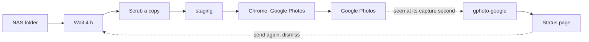

# gphoto

Copy camera photos to the NAS. About 4 hours later they are in Google Photos, shrunk by Google, on the day they were taken.

## Why it works this way

- Google's public API stores full size only. Google shrinks photos for its own apps, so a real Chrome does the upload with "Back up folders".
- Google refuses to shrink a Nikon D7100 JPEG that carries an MPF block. Without the block, a 9.5 MB photo became 663 KB. The block holds a small preview of the same photo. It is removed from the copy that is sent.
- Phone photos are left alone. The phone sends its own, and its MPF block is an HDR gain map.
- The 4 hours are for deleting bad shots. They count from when the file lands on the NAS.

## Parts

| Container | Job | Can reach |
|---|---|---|
| `gphoto-incoming` | Finds photos, waits, strips a copy, puts it in `staging` | NAS read-only unless `PHOTOS_ACCESS=rw`, no network |
| `gphoto-chrome` | Google Photos, signed in, watching `staging` | Internet, LAN desktop on port 3941 |
| `gphoto-google` | Checks Chrome, proves arrival, tidies `staging` | Chrome by a socket file, no network |
| `gphoto-web` | Status page, history, ops. The only one that can export telemetry | State read-only |



Each database has one writer: `incoming.db` and `google.db`, both in `state/`.

## How the NAS is watched

NFS does not report changes made by other machines, so it polls every 5 minutes. A folder is listed only if its modified time moved, or if a photo in it is waiting. Everything is listed once a day. Year folders before `SINCE` are skipped. A file's content is read only when it is due to go.

## What "In Google" means

Google Photos showed a photo at that capture second. A phone photo in the same second can stand in for it. Staged copies are removed 30 days after that. A photo that never arrives keeps its own copy and does not hold the others back. Dismiss it, or send it again. NAS files are changed only with `PHOTOS_ACCESS=rw`.

## Settings

All in `.env`. Run `docker compose up -d` after a change.

| Setting | What it does |
|---|---|
| `PHOTOS`, `SINCE`, `WAIT_HOURS` | Share to watch, first day, time to delete bad shots |
| `CAMERAS` | Makes to send. Default `NIKON` |
| `SCRUB` | What to take out of the sent copy. Default `mpf` |
| `PHOTOS_ACCESS` | `rw` cleans the NAS file too. Default `ro` |
| `SITE_HOST`, `ALLOWED_EMAIL`, `CF_ACCESS_*` | The page, and the one person let in |
| `LAN_ADDRESS`, `CHROME_*` | The Chrome desktop |

`SCRUB` groups: `mpf` (the preview that stops Google shrinking), `serial` (serial numbers and shutter count, which takes all maker notes with it), `gps`, `previews`, `names` (artist, copyright, owner, comments), `maker`. Capture time, time zone, rotation, colour, make and model can never be removed. If anything outside the listed groups would change, the photo is not sent and is shown as failed. Changing `SCRUB` changes the bytes, so a photo sent again after a change appears twice in Google.

`PHOTOS_ACCESS=rw` cleans a camera photo on the NAS in the same way, when it is due to go. The NAS file then has the same bytes as the copy Google has. Phone photos and photos sent before are left alone. The capture time and the file's modified time are kept. The share must be writable by this host only: give it its own NFS rule and user, not the rule other machines use. If it cannot be written, nothing is sent and the page says so.

One install is for one person.

## Telemetry

Numbers are kept in memory and shown on the Ops page. To export, copy `.env.otel.example` to `.env.otel`. Only the standard `OTEL_` variables are used, over OTLP http/protobuf. Each photo is one trace. Photo paths are left out unless `OTEL_GPHOTO_PATHS=true`. If the collector is down, photos are not affected, and what happened meanwhile may not be exported.

## Watching it

The page goes red and says what to do. Nothing is sent to you. For a monitor:

| Address | Answers |
|---|---|
| `/healthz` | `ok` while the page is up. Docker's health check. Never fails for a Google problem, because a restart does not sign Google back in |
| `/readyz` | `ok`, or `503` and `needs you:` with the steps in trouble, such as `chrome`. No sign-in needed, so it never names a photo |

Disk space under 2 GB on the Docker host is a problem on the page.

## What is kept

| What | How long |
|---|---|
| Container logs | 3 files of 10 MB each |
| History | 90 days, 100 a page |
| Database backups in `state/backup` | 7 days |
| Staged copies | 30 days after they are seen in Google |
| Charts on the Ops page | A day, in memory |

## Set up

1. Copy `deploy/` to the Docker host. Copy `.env.example` to `.env` and fill it in. Set `SOURCE` to this repo.
2. `mkdir -p config staging state control requests && docker compose up -d --build`
3. Open `https://LAN_ADDRESS:3941`. Sign in to Google Photos. Choose Storage saver in Settings.
4. Click **+**, **Back up folders**, and pick `/staging`.
5. Restart `gphoto-chrome`. Click **+**, **Folder backup**, **Update permissions**, **Allow on every visit**.

The status page needs Traefik and a Cloudflare Access application. The app checks the Access token itself, so going around Cloudflare is refused.

## Runbook

| Problem | Do |
|---|---|
| Anything odd, or after a host reboot | `docker compose up -d` |
| Signed out, or folder permission lost | Open Chrome on port 3941 and follow the status page |
| NAS check has not run | Check the NAS. A hard NFS mount waits for it, then carries on |
| Send one photo again, or stop flagging it | The buttons beside it on the page |
| Back up | The databases are copied daily. For the Google sign-in, stop all four and copy `config/gprofile/` |
| Restore a database | Stop all four, then copy `state/backup/state-*.db` over `state/incoming.db`, and `google-*.db` of the same day over `google.db` |
| `incoming.db` lost | Everything since `SINCE` is staged again with the same bytes. Google should match them, not tested |
| Update Chrome | Back up first. Chrome profiles do not go back a version. Change `CHROME_IMAGE`, then `docker compose up -d` |

## Develop

Needs Python 3.12 and exiftool.

```bash
pip install -r gphoto/requirements.txt pytest httpx
pytest
```
